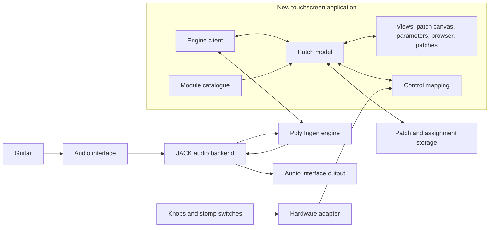

# Architecture

## Starting point — observed

Beebo's published `digit_ui` repository is a Qt/QML touchscreen interface wrapped in Python (PySide2, X11). It talks to Poly's Ingen fork, which hosts the actual LV2 processing modules, over a Unix socket at `/tmp/ingen.sock` using Ingen's RDF/Turtle message protocol. The small Python client it uses (`ingen.py`) is David Robillard's ISC-licensed Ingen client. Poly publishes the Ingen fork (AGPL-3.0) and separate effect repositories.

## Direction — agreed

- **New interface:** the touchscreen application is written from scratch for this project. Beebo is a reference for concepts and workflow, not a codebase to adapt.
- **Reused audio side:** Poly's Ingen fork and published LV2 modules remain the intended engine and module collection, extended with compatible MODEP LV2 effects.

The interface and the engine are separate programs connected by the engine's documented protocol. Original Peepo interface code and documentation use GPL-3.0-or-later, selected by the user on 13 October 2026. Ingen retains AGPL-3.0-or-later. Keep upstream notices with any reused code; see [third-party notices](../THIRD_PARTY_NOTICES.md).

Casette is an additional reference for native LVGL and NAM integration. It runs its UI and custom JACK effects chain in one executable; that structure does not meet our independent-interface requirement (R13). Retain the proposed separate interface and Ingen processes. [Casette findings](09-casette-and-nam.md) distinguish reusable lessons from hardware and implementation assumptions.

## Proposed component structure

This diagram describes intended responsibilities, not an implemented deployment.

### Audio backend

Reuse a compatible, verified JACK configuration where practical. Patchbox can already provide JACK, but running MODEP and a second engine together could compete for resources or create unintended routing. Establish the existing services and audio ownership before changing anything.

Select the actual input/output ports explicitly. Guitar input gain and impedance belong to the chosen audio interface.

### Audio engine

Start with Poly's Ingen fork, rather than assuming a distribution's generic Ingen package provides the same extensions. Confirm its protocol, custom properties, CV routing, MIDI mapping, plugin feature support, and patch format.

The engine owns audio processing and must keep running independently of the interface. Upstream notes that Ingen does not cope with Beebo's frontend restarting; our interface must therefore be designed to reconnect and re-read the engine's current graph, and this behaviour must be validated rather than assumed.

**Proposed:** keep all engine communication inside one *engine client* layer. The rest of the interface works with its own patch model. This keeps the protocol in one place and leaves room to substitute another LV2 host (for example `mod-host`, used by MODEP) if Ingen proves unsuitable. Substituting the engine is not an agreed decision.

### New touchscreen application — proposed structure

| Part | Responsibility |
| --- | --- |
| Engine client | Connect to the engine, send graph/parameter commands, receive updates, resynchronize after reconnection |
| Patch model | Modules, ports, connections, parameter values, canvas positions, and assignments; the single source of truth for the views |
| Module catalogue | Plugin list built from LV2 metadata plus a project-owned overlay (display names, groups, parameter pages, preferred editors) |
| Views | Patch canvas with cables, parameter pages, module browser, patch manager, settings; designed natively for 800 × 480 |
| Control mapping | Applies knob/switch events to parameters or actions, with ranges, pickup, and modes |

Interface work must never block audio. Long operations (loading patches, scanning plugins) run outside the drawing loop and report progress.

### UI toolkit — agreed: LVGL (D12)

The touchscreen interface will be built using **LVGL** (Light and Versatile Graphics Library) in C/C++.

**Rationale:**
- **Zero desktop overhead:** Runs directly on Linux DRM/KMS or direct framebuffer (`/dev/fb0`) with `libinput`/`evdev` touch input. It bypasses X11, Wayland, and window managers entirely, supporting the fast cold-boot requirement.
- **Low overhead objective:** Direct display access avoids a desktop session. Actual interface memory and CPU use depend on draw buffers, fonts, assets, widgets, and redraw rate and must be measured; the earlier <15 MB estimate was not established by a build or benchmark.
- **Embedded touch focus:** Built specifically for embedded touchscreen displays; provides native touch-gesture handling, draggable object capabilities, clean widget primitives (buttons, sliders, arcs, lists), and canvas/line rendering for virtual cables.
- **Portability and licensing:** MIT-licensed and portable. Develop the same project-owned interface/domain code on the Windows PC in an 800 × 480 simulator, then build it for Linux on the Pi; desktop Linux is another possible development environment.

### PC simulator and shared implementation — proposed

Use a pinned LVGL revision with the official Windows driver or compatible SDL backend for desktop display and mouse/keyboard input. The Pi build uses a validated direct Linux display/touch backend. Keep these drivers in a platform layer; share views, domain logic and typed engine contracts. A simulated engine supplies deterministic graphs, values and failures without requiring the Pi. It does not process audio or establish hardware performance.

The engine owns live DSP state; the UI patch model is its synchronized representation plus editor metadata and pending operations. Accept graph changes only after engine acknowledgment or authoritative updates. Socket work runs outside the LVGL thread and delivers queued updates to it. Establish these boundaries in Phases 1–4 of the [implementation plan](10-technical-implementation-plan.md).

### What we take from Beebo — and what we do not

Take as **reference**: the modular-patching concept, the idea of modules connected by cables on a canvas, per-module parameter pages, performance assignments, module groupings, and lessons from its engine integration.

Do **not** take: code, QML, Python modules, icons, fonts, images, or other assets; its 1280 × 720 layout; its hardware handler, firmware, storage, and maintenance routines. `digit_ui`'s README states that uncredited code is GPL without specifying a version. Our original interface uses the project's GPL-3.0-or-later license and targets our hardware. Third-party code and assets retain their own terms.

### Module catalogue

Generate the base catalogue from installed LV2 metadata (plugin URI, name, ports, ranges, units, scale points). Add a project-owned overlay file for display names, groups, parameter page layout, and optional custom editors. Every plugin gets a usable generic editor; custom editors (for example Clouds) are additions, not prerequisites.

Beebo's `module_info.py` may be consulted to understand groupings and which parameters matter musically. Its contents are not copied into the catalogue.

### Hardware adapter

Identify touch devices and physical controls by stable identities rather than assuming Casette's `/dev/input/event0`, `gpiochip0`, or GPIO numbers apply to the Pi 5. Its display overlays and HiFiBerry configuration describe different hardware.

Define a replaceable adapter between physical controls and musical actions. Possible transports are USB MIDI, Linux input events, or Pi GPIO through an adapter. Select one after the hardware is known.

Control events should be queued and applied through the application's own event processing, rather than manipulating UI objects from arbitrary input threads. Audio-thread work must remain bounded and independent of blocking control-device reads.

Keep the distinction between a knob assigned directly to a parameter and a stomp switch routed through a modular control block.

### Persistent state — agreed design (D13, revised 13 October 2026)

A patch is **one Ingen bundle directory** (`<patch_name>.ingen/` with `main.ttl`, `manifest.ttl`, `plugins.ttl` and any plugin state). There is no companion JSON file; that earlier design was dropped by the user on 13 October 2026 after the [engine evidence](14-ingen-engine-evidence.md).

Interface and control data are stored **in the engine, as properties** on the thing they describe:

- Canvas position: `ingen:canvasX` / `ingen:canvasY` on each block.
- User display name and colour: project properties on the block.
- Physical control assignments: project properties on the target port (control identity, range, pickup/mode, inversion). Assignments to actions that are not a port, such as patch change or tap tempo, go on the graph itself.
- Patch-level view settings: project properties on the graph.

Project properties use the `urn:peepo:ns#` namespace.

**Rationale (measured, not assumed):**
- The engine accepts these properties, returns them to a newly connected client before any save, writes them into the bundle and restores them on load.
- Layout and assignments therefore survive an interface crash or restart, which a file owned by the interface could not offer (R13).
- One directory is one patch: there is no pair of files to keep coherent.
- The bundle stays readable by a stock Ingen, which ignores properties it does not know.

If the project properties are missing or unreadable, the audio graph still loads and the interface places squares on a default grid. Anything that turns out not to fit a property on a block, port or graph needs a new decision; none is known.

Use documented application directories for presets, user audio assets, assignments, and settings. Patch saving should avoid partially written state and distinguish the startup patch from unsaved edits. Stored plugin references should use stable LV2 URIs and port symbols.

Save into a staging directory, wait for the engine's reply, then publish the complete bundle by renaming it, keeping the previous complete revision until the new one is in place. Define staging, revision selection and recovery in Phase 5 of the implementation plan.

### NAM and resource handling — proposed

Evaluate NAM as an LV2 module hosted by Ingen. The downloaded Poly fork uses an older NAM Core integration; current upstream `neural-amp-modeler-lv2` uses NeuralAudio. Compare compatible, pinned builds without replacing Ingen or importing Casette's fixed chain. Verify the selected plugin's required features, file-path messages, worker support, and state restoration.

Prefer mono amp processing for a mono guitar input and introduce stereo at effects that need it. Models and IRs are external audio assets; their references and plugin state belong to the saved audio graph, alongside canvas positions and control assignments stored as engine properties. Provide calibrated input/output controls and quality selection only where supported.

Load, initialize, and release models outside the real-time callback. Transfer ownership through the host/plugin's supported mechanism, handle failures, and avoid retaining unused models indefinitely. NeuralAudio composite-model initialization can trade memory for readiness to change quality; a first switch to an uninitialized submodel must not run on the audio thread. This needs verification in the selected LV2 implementation, not only its library API.

Parallel audio cables do not guarantee multicore execution. Measure JACK DSP load, per-thread/core use, processing-time peaks where available, xruns, process memory, system available memory, and thermal throttling. At 48 kHz a 64-sample block has a 1.33 ms scheduling period; that arithmetic is not a measured round-trip latency. Keep full-patch headroom before enabling additional expensive modules. Automatic quality reduction remains open; user-selected quality must be visible and saved.

## Startup design — proposed

1. Initialize Linux and the audio interface.
2. Start the audio backend with the verified device configuration.
3. Start Ingen with its plugin search paths and startup graph.
4. Restore the selected patch and connect the intended audio ports.
5. Start the new interface full-screen, without a desktop session, once the engine is reachable.
6. Enable physical control handling and show readiness or a useful error.

Use actual readiness checks, not only fixed sleep durations. Local operation should not wait for internet access. Service dependencies and the graphical startup mechanism depend on the identified OS and the chosen toolkit.

## Plugin locations

Inventory normal LV2 search directories and MODEP's `/var/modep/lv2` where present. An explicit `LV2_PATH` can expose selected bundles to Ingen, but it does not resolve incompatible binaries, missing libraries, unsupported features, or missing catalogue entries.

Prefer separate tested plugin sets and reproducible versions during development. Keep the working MODEP system recoverable until the new instrument passes audio and restart checks.

## Device functions

Beebo's firmware updates, overlay maintenance, factory reset, storage remounting, codec gain/inversion, and hardware bypass are not part of the new interface. Any equivalent Pi functions — software updates, reset to defaults, input gain via the audio interface's ALSA mixer where supported, shutdown — are designed fresh when needed.

If power-off is offered through the instrument, define how settings finish saving and how Linux shuts down. A read-only root filesystem or overlay is an optional later design; persistent patch storage must be considered separately.
