# Windows UI foundation

**Started:** 13 October 2026. **Scope:** accepted Phase 2 desktop editor and most shared Phase 1 contracts; Phase 0 waits until the Pi is unpacked.

The same C++ domain and LVGL views are used by the Windows application and the headless interaction checks. The simulated engine contains only demo graph data. Clouds, Drive, Delay, Reverb and Mono utility are UI fixtures; NAM and Cabinet are disabled status examples. They do not discover or load real LV2 plugins, describe verified plugin parameters, check actual installed assets, or process audio.

## Build and run

Verified toolchain: Visual Studio Build Tools 2026 18.1.1, MSVC 19.50.35721, Windows SDK 10.0.26100.0, CMake 4.2.1, x64. No new compiler installation is needed on this PC. CMake requires 3.25 or newer; the included VS 2026 preset requires a CMake version supporting that generator.

```powershell
cmake --preset windows
cmake --build --preset windows --parallel 6
ctest --preset windows
& '.\build\Debug\peepo.exe'
```

For VS 2022, configure separately with `cmake -S . -B build-vs2022 -G "Visual Studio 17 2022" -A x64`, then `cmake --build build-vs2022 --config Debug` and `ctest --test-dir build-vs2022 -C Debug --output-on-failure`. That alternate toolchain has not been tested here.

LVGL v9.5.0 is pinned to `85aa60d18b3d5e5588d7b247abf90198f07c8a63` from [the official source](https://github.com/lvgl/lvgl/tree/85aa60d18b3d5e5588d7b247abf90198f07c8a63). CMake FetchContent stores it under the ignored build directory. Initial configuration needs Git and internet; ordinary builds and launches reuse the dependency without upgrading it. For an existing offline checkout use `-DFETCHCONTENT_SOURCE_DIR_LVGL="C:/path/to/lvgl"` when configuring. That checkout must match the recorded commit.

The Windows driver ships in that LVGL revision. Simulator mode keeps an 800 × 480 logical display and mouse/keyboard input; Windows DPI may scale its physical presentation. No SDL, Qt, web browser, or audio host is required. Built-in LVGL Montserrat fonts provide the typography. Original source has GPL-3.0-or-later notices; fetched third-party source retains its own notices. The build copies dependency license notices beside the executable.

`cmake/lvgl_windows_fix.cmake` applies a two-call correction to a generated copy of LVGL's Windows OS abstraction: `TerminateThread` and `CloseHandle` need the dereferenced thread handle. The interaction check exposed an invalid-handle exception during `lv_deinit` before this correction. The original fetched checkout is unchanged. Recheck this patch and the single private hit-test payload header used in `application.cpp` when upgrading LVGL.

### Debugging

`.vscode/tasks.json` provides configure, build and test tasks; `.vscode/launch.json` launches either the Windows simulator or domain/engine checks with the Microsoft Windows C++ debugger. The configuration specifies the executable, working directory, PDB search path and exact-source matching using [Microsoft's C/C++ debugging configuration](https://code.visualstudio.com/docs/cpp/launch-json-reference).

Open this folder in VS Code with Microsoft's C/C++ extension (`ms-vscode.cpptools`), configure the Windows preset, choose **Peepo: Windows simulator** in Run and Debug, and press F5. Useful breakpoints are `Application::handle`, `Application::tick` and `SimulatedEngine::apply`. F10 steps over a call; F5 continues. Inspect `graph_` after acknowledgment and `pending_` before it. Build with Ctrl+Shift+B; run **Peepo: test** from Tasks for the full checks. Stop the running simulator before rebuilding its executable.

The Debug build/PDBs and JSON configurations are present and checked. The C/C++ extension is not installed on this PC (CMake Tools is present); no debugger session or breakpoint was verified. P1.1 therefore still includes debugger setup/validation. Linux platform/debugger setup awaits the actual Pi OS decision.

## Explore the UI

- (Superseded 17 October 2026 by [the bar page](31-module-page-and-two-encoders.md); the images below show it.) Tap Drive for generic parameters, Clouds for Texture / Mix-hold tabs, or Delay for Character mode buttons and echo controls. **All** opens the generic view for custom modules; **Custom** returns. Drag sliders or use switches/selectors; values update after engine acknowledgment. Generic **< / >** pages show four controls at a time.
- Open **Patches → Parallel demo** to try Drive splitting into Clouds and Delay, with both branches returning to OUT. Confirm replacement if the current graph has unsaved edits. Each branch can be edited, disconnected and reconnected with ordinary cables.
- The bottom-right footer shows global **BPM** and **CPU** on every page. In this simulator, 120 BPM and 12% CPU SIM are fixed display fixtures, not measured performance or a running tempo clock. CPU shows `--` outside Ready. Real engine adapters can provide optional live readings; unavailable or invalid readings show `--`.
- Drag a module body to move it on a 24-pixel grid. IN and OUT are fixed.
- Drag empty space to pan a 4096 × 2048 logical canvas. **Home** restores the original view without moving modules or editing the graph.
- Hold a module to open **Parameters**, **Software bypass**, **Duplicate** and **Delete module**, or use **Actions** on its parameter page. Duplication creates a fresh instance with the same parameter values and bypass state; cables and physical control assignments stay with the original.
- Drag an output jack on the right to an input jack on the left. Split/merge diagrams can be explored in the simulation; their real audio behavior remains unverified. Feedback loops and duplicate cables are rejected.
- Valid input jacks are highlighted during cable dragging. Tap a cable to select it; use **Delete cable** or **Deselect** in the footer. Selection alone leaves the graph unchanged.
- Use **+ Add** to open the paginated demo catalogue. Available entries can be added; Untested and Unavailable entries have disabled buttons. Tap their rows for the reason. New modules occupy a vacant visible grid slot, or a free slot on the larger canvas which the UI reveals automatically.
- Use **Patches → New patch** or **Rename** for name entry. Type on-screen or with the PC keyboard. Checkmark/Enter accepts; the keyboard cancel button or Back leaves the current graph intact. New typed names are limited to 48 characters; an existing longer backend name is preserved when Rename opens. A new patch starts with IN connected to OUT. Replacement of unsaved edits can be cancelled without losing the typed draft.
- **Patches** keeps patches on disk (since 14 October 2026), in `%LOCALAPPDATA%/Peepo/simulator-patches` for the simulation or a folder given with `--patches`. **Save** writes a new revision of the playing patch, **Save as** a separate copy under a new name; each row offers **Load**, **Startup** and **Delete**. Loading over unsaved edits, deleting, and loading a patch with an unavailable module ask first. The simulation writes the engine's bundle layout without plugin state. See [patch storage](17-patch-storage.md).
- Without a patch folder, **Save snapshot / Load** keeps one in-memory session snapshot, as before: it goes through the engine, clears the dirty marker on success and survives new patches and reconnect until the process closes.
- Use **Settings** to reconnect, disconnect, simulate an error or reject the next engine edit. Returning to ready preserves the graph and passes through Connecting. While the engine is away the header says STARTING, RECONNECTING, OFFLINE or ENGINE ERROR, a banner on the patch gives the reason, and **+ Add** is disabled; against a real engine, Settings shows the connection and the patch folder instead. **Missing module** loads a repair fixture with retained settings/cables and an orange placeholder; inspect, move or delete it. Its parameters, bypass, duplication and new cables are disabled; orange cables are inactive.
- (Superseded 17 October 2026: two encoders, Q/A and W/S, keys 1 and 2; see [module page and two encoders](31-module-page-and-two-encoders.md).) Keys stand in for the four encoders and three footswitches: Q/A, W/S, E/D, R/F turn encoders 1–4, keys 1–4 push them, Z, X and C are the stomps. On a parameter page the encoders follow the tiles (marked E1–E4); push and turn is fine, a tap moves to the next page, and holding pins an encoder to its control. **Settings → Controls** assigns stomps and pinned encoders. See [physical controls](18-physical-controls.md).
- Tab traverses controls and Enter activates buttons. Arrow keys adjust focused sliders. Physical printable keys enter names, and Enter accepts the name; mouse/touch-style navigation remains the primary development workflow.

## Code boundaries

| Path | Responsibility |
| --- | --- |
| `src/core/` | Stable IDs/URIs/display names, explicit port types/channel symbols, tagged parameters, graph validation, logical/physical routing plans and retained missing-module metadata; no LVGL/Windows dependency |
| `src/catalogue/` | Catalogue files exported from installed plugins: reader, writer, overlay rules and a small JSON reader; see [the catalogue record](16-catalogue-export.md) |
| `src/engine/ingen/` | The real engine backend: Turtle reader, protocol, session state machine, socket threads and `IngenEngine`; see [the adapter record](15-ingen-adapter.md) |
| `src/storage/` | Saved patches: the bundle reader and the simulator's writer, and the patch store with revisions, staging and the startup choice; see [patch storage](17-patch-storage.md) |
| `src/controls/` | Physical controls without LVGL: raw events, gesture recognition, mapping rules and soft takeover; see [physical controls](18-physical-controls.md) |
| `src/platform/linux/` | The Linux program (DRM/KMS, framebuffer, SDL or offscreen display, evdev touch) and the controls read from the kernel's input devices; see [Linux and Pi](19-linux-and-pi.md) |
| `src/engine/` | Abstract engine interface and deterministic backend; connection lifecycle, capabilities, requests, 100 ms delayed results, snapshots, new/rename/session save/load and errors |
| `src/ui/` | Shared LVGL screens and view state; callbacks queue edits and screen rebuilds happen outside event dispatch |
| `src/platform/windows/` | Native display/input initialization and event loop |
| `config/lv_conf.h` | LVGL configuration and selected fonts |
| `tests/` | Domain/engine checks, catalogue files (`catalogue_tests`), bundles and the patch store (`storage_tests`), gestures and mapping rules (`controls_tests`), the Ingen adapter against a stand-in engine (`ingen_tests`) and a live one (`ingen_live`, `catalogue_live`), and actual LVGL pointer interactions on an in-memory display |

The simulation owns the graph. The application consumes accepted snapshots and keeps pending requests separately. Continuous sliders send their value while the finger moves: one request is in flight per control and the newest value replaces anything waiting, so the rate follows engine acknowledgment. Release sends the final position; a touch that moves nothing is not an edit. Disconnect cancels queued edits so reconnect cannot apply stale requests. UI drawing and simulation updates run on the LVGL thread under its Windows lock; a future network adapter will need its own I/O thread and bounded event queue.

The simulator advertises session snapshots and persistent saves, and explicitly rejects plugin-state requests. The shared UI uses the abstract `Engine`. Optional simulation controls default to unsupported for future real adapters. [Domain and engine contracts](13-domain-and-engine-contracts.md) record identity, numeric tags, availability, lifecycle and routing semantics. Mono/stereo routing plans use supplied channel symbols where present; demo `_L`/`_R` fallbacks are not verified real Ingen ports. Multiple links into one input have no measured merge compensation.

## Verification

**13 October 2026 result:** Debug build succeeded; all three CTest checks passed (native Windows rendering/close, domain/engine validation and actual LVGL pointer/keypad workflows). P1.2, P1.4–P1.8 and P2.1–P2.10 are complete. The [recorded desktop review](12-desktop-editor-review.md) establishes Phase 2 desktop acceptance. P1.1/P1.3 retain debugger/Linux platform work.

`ctest --preset windows` runs domain/engine checks, the real LVGL pointer workflows and a native Windows-driver rendering/close check. The native check requires an 800 × 480 buffer, a completed display flush and substantial background/module pixels before any user click; it writes `build/windows-render-check.txt` and a capture of the native buffer in `build/windows-render-check.bmp`. Pointer checks cover parameter controls, dragging, panning without graph changes, transformed cable gestures, explicit cable selection/deletion, long-press actions, duplication, rejected duplication, session restore, disconnect/reconnect and backend graph replacement. A 15-module fixture verifies adding beyond a full viewport and revealing the new module. Domain checks verify fresh IDs, independent values, preserved software bypass, unchanged cables/assignments and canvas bounds. Captures of the actual LVGL views are saved as 800 × 480 BMPs under `build/screenshots/`; PNG review copies are kept under `docs/images/`.

**Editor update, 13 October 2026:** the logical canvas now extends beyond the viewport. LVGL pointer capture preserves module/cable/pan gestures, and release handlers use the final pointer sample even when no last movement event was delivered. The dense-view review moved Home into the header and cable actions into the footer so controls do not cover module rows. Physical switch assignments are deferred to Phase 7.

**Desktop completion, 13 October 2026:** added new/rename naming, unsaved-replacement guards, session commands through the engine, parameter/catalogue pagination, availability reasons, missing-module repair and explicit mono/stereo expansion. Tests cover on-screen and physical keyboard input, Backspace/OK/Cancel, rejected creation/save, preserving an existing session after new-patch creation, existing long-name preservation on Rename, and missing-module deletion. Review fixed keyboard bottom alignment, constrained long patch labels to one header line, and added visible slider knobs. Widget rebuilds now also wait for keypad release: rebuilding while Enter was held had allowed the new screen's Back button to receive its release. Keyboard geometry checks require each tested key to fit in the viewport with at least 44 pixels of height. The test uses a second isolated LVGL private header to locate keyboard button geometry; recheck it on dependency upgrades.

**Module UI extension, 13 October 2026 (P2.9):** Clouds opens Texture and Mix / hold tabs; Delay opens Character buttons with separate timing, feedback and mix controls. Tap All for the generic editor and Custom to return. Both use the same acknowledged parameter commands. Changed parameter schemas fall back to the generic view. Patches → Parallel demo loads an editable stereo split/merge example through the existing unsaved-replacement guard: IN → Drive → Clouds / Delay → OUT. Tests cover custom controls, rejected modes, fallback value continuity, extra metadata, cancelled/rejected preset loading and branch deletion/reconnection. These fixtures still process no audio.

**Startup fix, 13 October 2026:** the earlier launch/close check passed even though the window was blank. The Win32 drawing buffer is created on a deferred driver timer; a refresh before that timer paused the refresher, and an existing full-screen invalidation suppressed further refresh requests. The Windows loop now resumes the initial refresh once the buffer exists and tracks display deletion before accessing it during shutdown. The strengthened native check reproduces the old blank-screen failure and verifies the corrected first frame.

**Reference metadata, multi-port jacks and live controls, 13 October 2026 (P2.11):** `tools/export_lv2_catalogue.py` reads the unchanged `reference/upstream/lenticular_lv2/*.ttl` files and generates `src/core/reference_catalogue.cpp`: 21 Mutable Instruments-derived plugins with their real URIs, port symbols and control ranges. Regenerate it with `python tools/export_lv2_catalogue.py reference/upstream/lenticular_lv2 > src/core/reference_catalogue.cpp` (needs `pip install rdflib`). Each audio port is one connector under its real symbol (`l_in`, `r_in`, `carrier`, `modulator`). The LV2 `enabled` control is treated as software bypass. A cable now carries the port it was dragged from and the jack it was dropped on. Values in narrow ranges show two decimals.

**Free patching, 13 October 2026 (user-requested):** every audio port is its own connector and every cable is one channel. A stereo module shows two connectors per side, left above right, and each is patched, selected and deleted on its own, so the left output can go through one effect and the right through another. The earlier merged stereo cable and the MONO/STEREO label on squares are gone. The generated catalogue no longer pairs left and right ports. A normal stereo chain now takes two drags per connection.

**Control cables, 13 October 2026 (user-requested):** modules with control outputs show an amber square connector on top, modules with control inputs one underneath. Dragging between them opens a port list (eight per page) for the output and then the input. Grids, Marbles and Tides are now available in the browser. Port lists show the plugin's raw symbols such as `slope_input`.

**Module browser by category, 14 October 2026 (user-requested):** "Add a module" now opens as a scrollable list of collapsed category headers (Drive, Amp, Cabinet, Dynamics, Filter, Modulation, Pitch, Delay, Reverb, Texture, Resonator, Sound source, Utility, then any other category alphabetically). Tapping a header opens it, closes any other open category, and scrolls it to the top. Each module row shows only its name and description; tapping the row adds the module. Pages, per-row Add buttons and status labels such as DEMO / available are gone, and so is the bottom message/BPM/CPU bar on this screen. Untested and unavailable entries are dimmed, cannot be tapped, and show their reason in place of the description. Every visit starts with all categories closed.

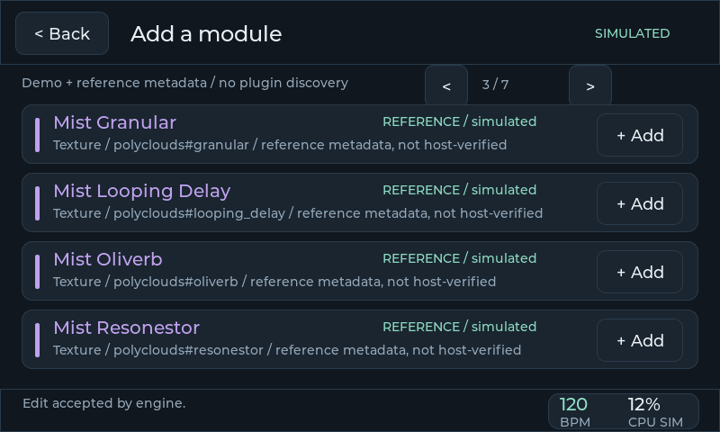

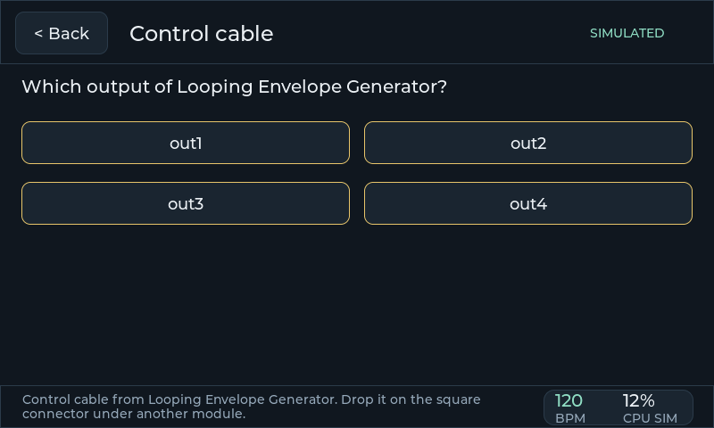

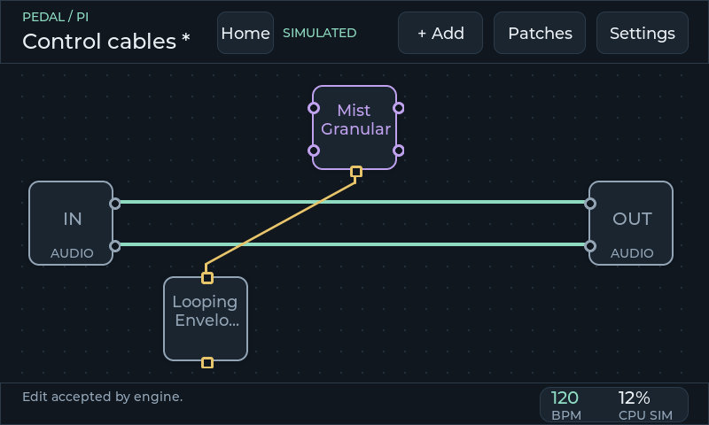

This is metadata only: nothing was built, loaded in a host or heard. The upstream files declare no units, toggles, integer steps or enumerations, so Freeze appears as a 0-1 slider and names are raw (Rings is published as "Random CV Sampler"); the planned presentation overlay has to supply those. The hand-made Clouds and Delay fixtures and their custom pages remain for the existing checks; they do not match the real Clouds parameters. Cable drawing still overlaps when two cables leave one jack for the same module.

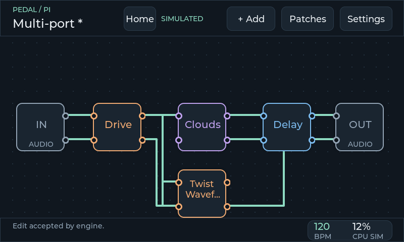

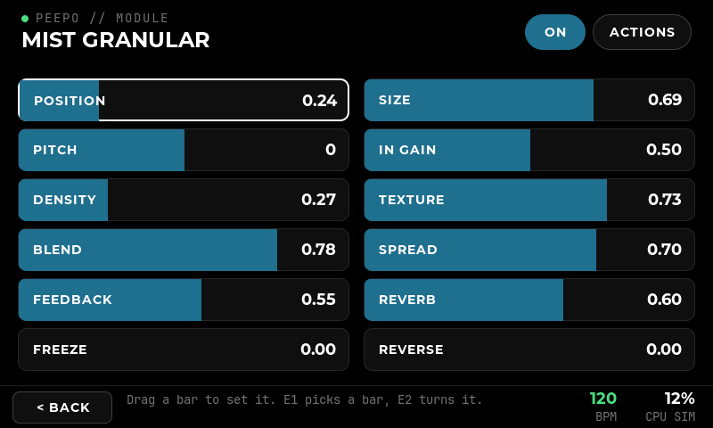

These checks verify desktop interaction and drawing. They provide no evidence for Pi touch usability, Linux deployment or audio performance. Upstream LVGL emits enum-combination warnings with this compiler; original project files should compile without warnings.

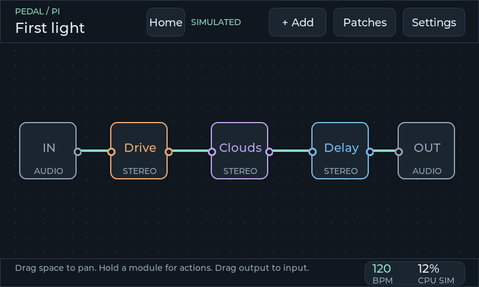

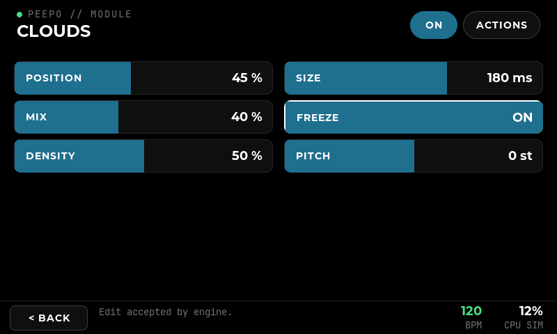


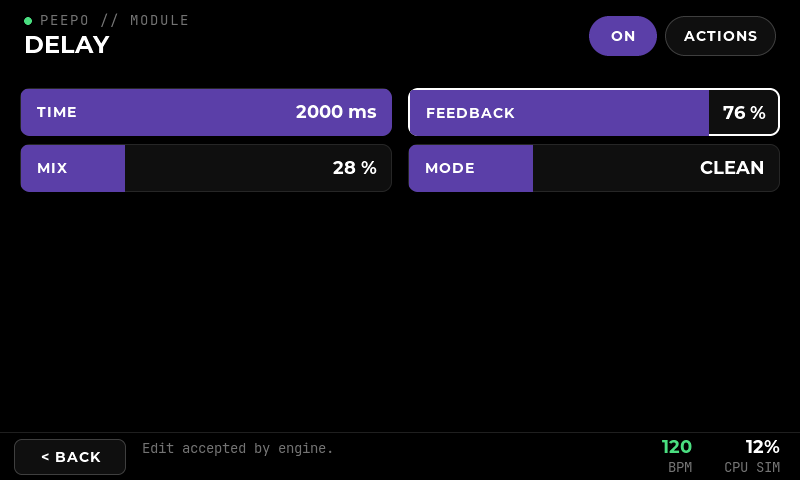

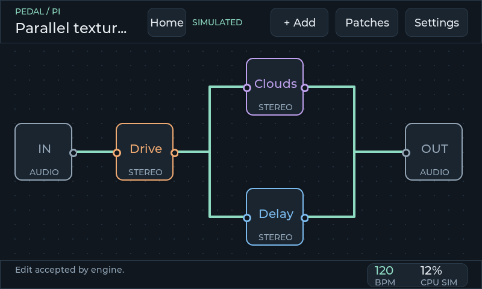

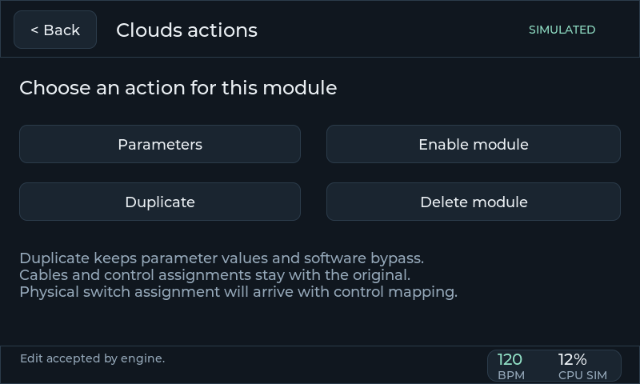

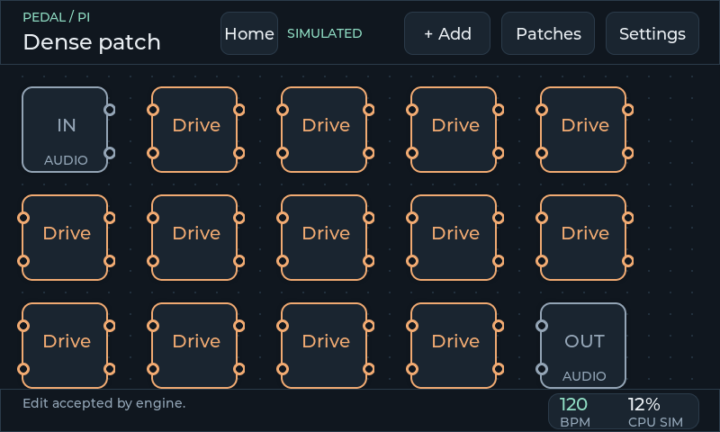

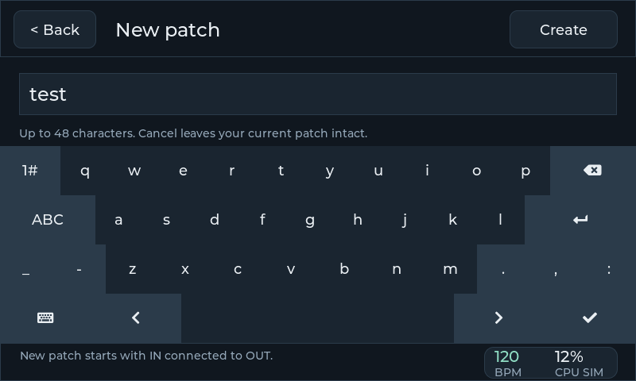

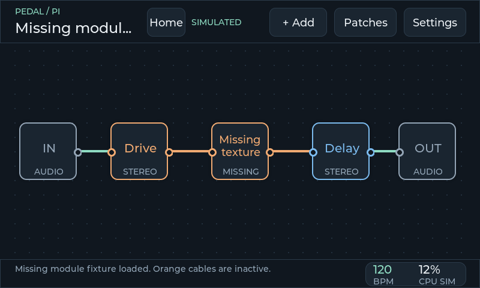

## Remaining work

Phase 1 still needs C/C++ debugger installation/runtime validation and the Linux UI build route/platform target once the OS is known. Phase 2 desktop scope is accepted. The current catalogue has five available demo effects, two disabled status fixtures, and a category-grouped module browser. Actual plugin discovery, protocol adaptation, audio port identities and merge levels are later integration work.

The palette and typography are a first proposal for review. They can be changed independently of hardware. Phase 0, physical control assignments and audio measurements on the Pi remain deferred; real Ingen integration and patches on disk are recorded in [the adapter record](15-ingen-adapter.md) and [patch storage](17-patch-storage.md).
