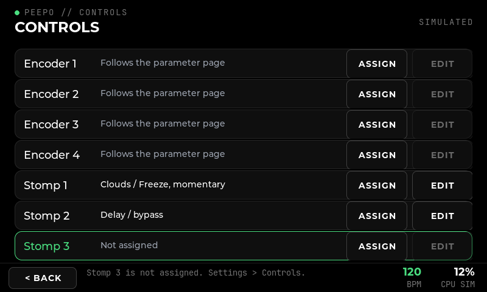
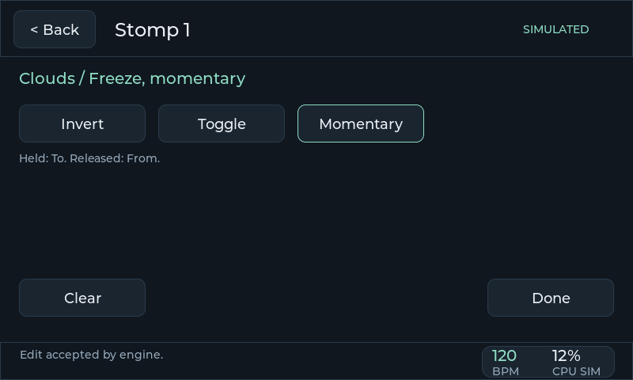
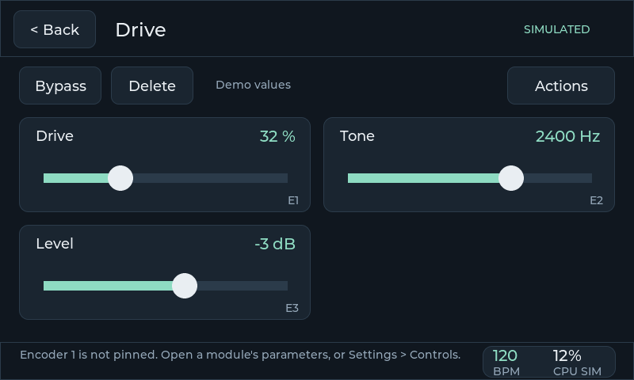

# Physical controls

**Implemented:** 14 October 2026, on the Windows PC, without the hardware. **Scope:** P7.2 (simulated controls), P7.4 (mapping rules), P7.5 (assignment screen and storage), the patch-independent part of P7.6, and a wiring and transport proposal for P7.1. **Verified with:** unit tests, real LVGL pointer checks, the simulator, and against the patched Ingen under WSL, where assignments are saved and reloaded. **Not covered:** the encoders and switches themselves, the GPIO driver (P7.3), tap tempo and the resilience checks of P7.7.

## The hardware

The user owns **four 20-pulse rotary encoders with push switches** and can get **momentary SPST footswitches**. Beebo uses two encoders and three stomps; the proposal here is four encoders and three stomps (D11, now the agreed starting point).

**Momentary SPST footswitches are the right choice.** A momentary switch tells the instrument only "pressed" and "released"; what that means is decided in software, per patch:

- **Toggle:** each press flips a parameter or a module's bypass.
- **Momentary:** a value is held only while the foot is down.
- **Patch changes and, later, tap tempo:** each press is one event.

A **latching** switch would be wrong here. Its physical position would disagree with the patch as soon as the patch changes, or the same effect is switched on the screen; it can also do nothing useful for momentary, tap or hold actions. Prefer "soft-touch" momentary types if quiet operation on stage matters. Both kinds work electrically.

Four encoders suit this interface: a generic parameter page shows four controls, and the encoders follow them one-to-one.

## Wiring proposal (P7.1 — proposed, to verify on the Pi)

Everything connects directly to the Pi 5's header, with no extra board: the screen uses HDMI and USB, so the GPIO header is free. Each encoder needs three GPIOs (A, B, push) and each stomp one, **15 GPIOs** in total, all switching to ground with the Pi's internal pull-ups.

| Control | A | B | Push / switch |
| --- | --- | --- | --- |
| Encoder 1 | GPIO 5 | GPIO 6 | GPIO 12 |
| Encoder 2 | GPIO 13 | GPIO 16 | GPIO 17 |
| Encoder 3 | GPIO 22 | GPIO 23 | GPIO 24 |
| Encoder 4 | GPIO 25 | GPIO 26 | GPIO 27 |
| Stomp 1–3 | GPIO 4, GPIO 7, GPIO 8 | | |

- **Pins left free.** I²C (GPIO 2/3, which have fixed pull-ups), the UART (14/15) and I²S (18–21) stay free, in case an audio HAT or a serial console is wanted. Stomps 2 and 3 use SPI0's chip selects, which nothing here needs.
- **Encoders.** The common pin and one push-switch leg go to ground.
- **Stomps.** One terminal to the GPIO, the other to ground. Long footswitch leads benefit from twisted pairs and a 100 nF capacitor across the switch; software also ignores bounces (below).

**Transport (proposed):** the kernel's own drivers, enabled in `config.txt`:

- `rotary-encoder` overlays turn each encoder into relative-axis input events;
- `gpio-key` overlays turn each push and stomp into key events.

The kernel decodes the quadrature (and so ignores contact bounce on A/B). Each encoder is given its own relative axis and each push or stomp its own key code, so the interface recognizes them by the codes they report, whatever the device numbering (`config/pi/controls.conf`). A 20-pulse encoder with 20 detents gives one full quadrature cycle per detent; whether the overlay reports one step per detent must be checked on the bench. If the overlays prove unsuitable on the Pi 5, the fallback is reading the pins directly with libgpiod. The adapter that reads these devices (P7.3) now exists and is tested with virtual devices ([Linux and Pi](19-linux-and-pi.md)); what remains is checking it against the real parts.

## How the controls behave

Every source — the simulator's keys today, the GPIO adapter later — produces the same raw events: **Turn** (detents, clockwise positive), **Press** and **Release**. `ControlRecognizer` turns them into gestures; the interface applies them. Nothing else depends on where the events come from.

**Encoders**

- **Turn** adjusts a value. By default an encoder **follows the parameter page in view**: encoder 1 the first tile, encoder 2 the second, and so on, on generic and custom pages alike. Each tile is marked E1–E4. On other pages an unpinned encoder does nothing, and says so.
- **Push and turn** is fine adjustment.
- **Tap** (push, release without turning) moves to the next page of parameters. A pinned encoder's tap opens the page of what it controls.
- **Hold** (0.7 s without turning) **pins** the encoder to the control it is turning: it then controls that parameter on every page, until held again to unpin. The tile shows "E2 pinned".

**Stomps** act on the press itself, never waiting for a gesture to end:

- **Toggle:** each press switches between the ends of the assigned range (off/on for a switch such as Clouds freeze).
- **Momentary:** the far end while held, the near end on release.
- **Bypass:** each press switches a module's software bypass.
- **Next or previous patch:** instrument-wide (below).
- A press closer than 25 ms after a release is a bounce and is ignored.

Switch actions go to the engine at once; only encoder turns are coalesced (one value in flight, newest wins), so a stomp is never delayed behind a stream of knob movement. Controls are ignored while a name is being typed.

## Mapping rules (P7.4)

| Kind | One detent | Notes |
| --- | --- | --- |
| Continuous | 2 % of the range (fine: 0.2 %) | In the parameter's own scale, so a logarithmic frequency moves by even ratios |
| Acceleration | ×2 under 100 ms between detents, ×3 under 50 ms, ×5 under 25 ms | Bounded; never when fine; 20 detents per turn means about 2½ turns end to end, under one when spun |
| Integer | ±1 | Accelerates only when the range spans more than 24 values |
| Choice | ±1 | Stops at the ends, never wraps |
| Switch | Clockwise on, anticlockwise off | |

- **Range and inversion.** An assignment may narrow the range (From/To) and invert the direction. A value outside the narrowed range comes into it on the first detent.
- **No jumps.** Encoders are relative, so a patch change can never make a value jump.
- **Absolute controls.** For potentiometers or an expression pedal, if ever added, `Pickup` implements soft takeover: the control takes effect only once it reaches or crosses the current value.

## Assignments (P7.5)

**Settings → Controls** lists the four encoders and three stomps. Each row shows its assignment, an orphan in orange, or "Follows the parameter page" / "Not assigned". Using a control highlights its row, which is how to find which physical knob is which.

- **Assign** picks a module, then a parameter. Stomps also offer **Bypass**, and **Next patch** / **Previous patch**.
- **Edit** sets Invert, Toggle or Momentary, the From and To ends of the range, or clears it.

**Storage.**

- **Per-patch assignments** are graph properties, one per control: `pedalpi:control-enc1 "parameter|m4|<plugin>|mix|0|100|0|toggle"`. They therefore live in the engine and in the saved bundle, like everything else (D13), and survive an interface restart.
- **The plugin is recorded.** A different module that later holds the same identity is never controlled; the assignment is shown as orphaned and is never applied.
- **Removing a module** removes its assignments in the same edit. Duplicating one does not copy them.
- **Patch changes are instrument-wide.** A footswitch that changes patch must do so in every patch, so those actions are kept beside the patches (`<patches>/controls`), not in one. A patch's own assignment of the same stomp takes precedence while it plays.
- **Unsaved edits are guarded.** A patch change from the footswitch asks first if the current patch has unsaved edits, exactly as on screen.

## Trying it in the simulator

| Keys | Control |
| --- | --- |
| Q / A, W / S, E / D, R / F | Turn encoders 1–4 clockwise / anticlockwise (holding a key repeats, which shows acceleration) |
| 1, 2, 3, 4 | Push encoders 1–4 |
| Z, X, C | Stomps 1–3 |

The keys work in the Windows build against the simulation or a real engine. They still reach LVGL, where they are text on the name page; the interface ignores them as controls there.

## Verification

- `pedal_controls_tests`: gestures (tap, hold, fine, bounce, repeated presses) and every mapping rule above. It also covers soft takeover, encoding, validation of assignments and orphans, and assignments in the simulator: replaced per control, removed with their module, saved and loaded through the patch store. The instrument-wide actions are covered too.
- `pedal_ingen_tests`: assignments as engine graph properties, seen by a second client, kept across an interface restart, cleared by a new patch, saved, loaded and removed with their module.
- `pedal_ingen_live` against the real engine: an inverted encoder pinned to Mist Granular's first control is saved and comes back from disk.
- `pedal_ui_check`, through the same entry point the hardware will use:
  - encoders following Drive's tiles, then fine steps, pinning, the pinned encoder working from the patch page, tap to show and unpin;
  - following on Clouds' custom pages, with a tap moving to the next page;
  - the Controls page assigning stomp 1 to Clouds freeze in toggle and then momentary mode, and stomp 2 to Delay's bypass;
  - an unassigned stomp, controls ignored while typing a name, a removed module taking its assignment along, and a next-patch footswitch stepping through stored patches and wrapping.

## Open points

- **P7.3:** the adapter that reads the kernel's input devices exists and is tested with virtual devices; the overlays, bindings and boot lines are in `config/pi/` ([Linux and Pi](19-linux-and-pi.md)). Still to check on the real parts: the overlays themselves, the steps per detent and switch bounce.
- **P7.6:** tap tempo needs a tempo the engine can use; none exists yet. A second action on a held stomp is not defined.
- **P7.7:** unplug/reconnect does not apply to wired GPIO controls; a UI restart, patch reload and rapid gestures should be repeated on the Pi.
- **While the interface is down** the controls do nothing: they are read by the interface. Controls that keep working through an interface restart would need a separate control daemon, which the engine supports as a second client.
