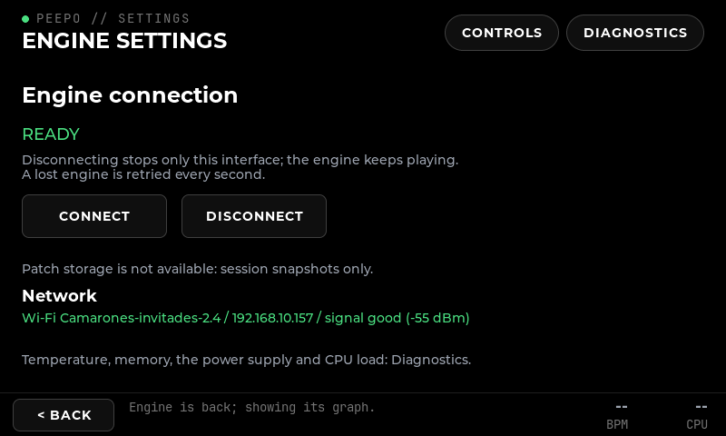
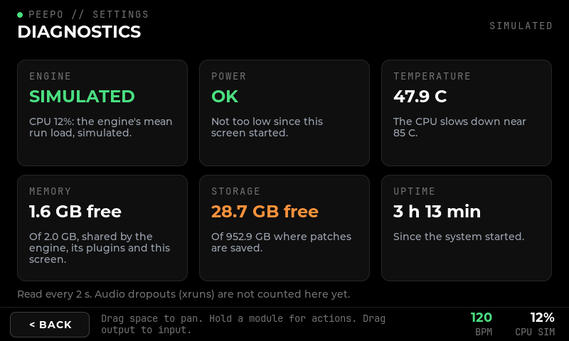
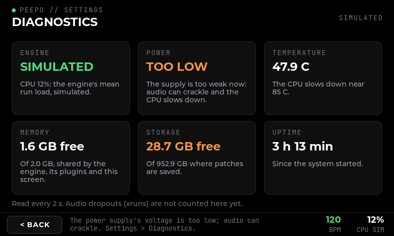
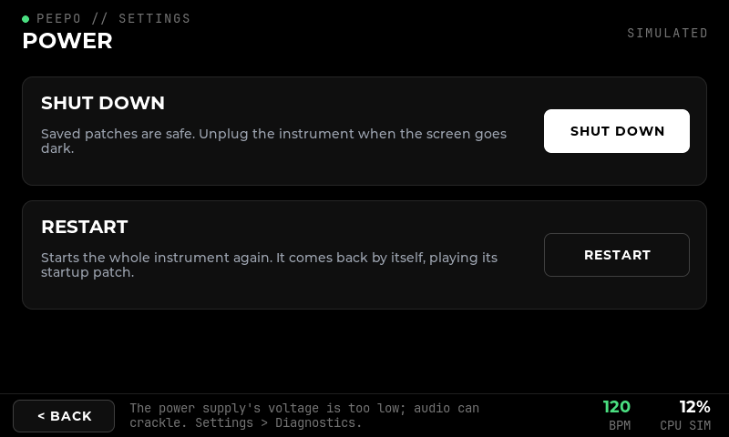
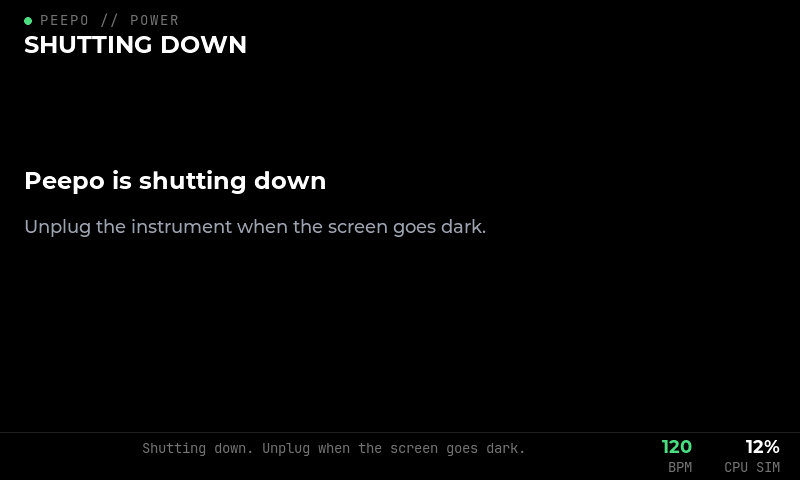
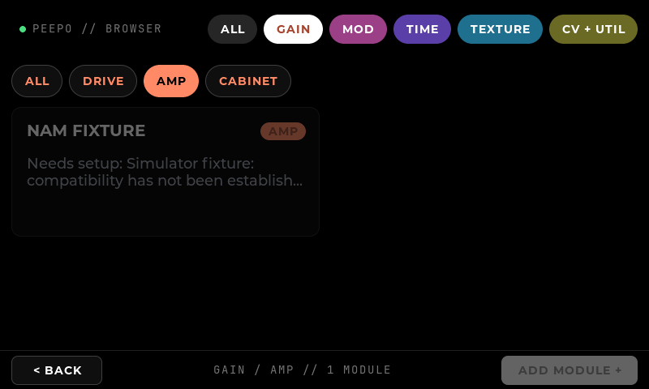
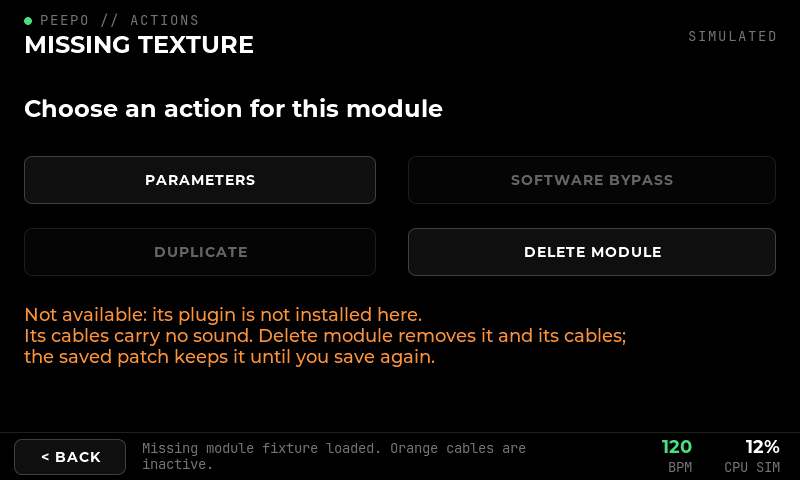

# Remaining screens: diagnostics, power, browser categories, repair states

**Implemented:** 16 October 2026, on the Windows PC. **Scope:** P9.5 (browser filtering, patch management, diagnostics, shutdown navigation, missing-plugin/asset repair states). **Verified with:** real LVGL pointer checks on Windows, the new Linux reading test under WSL2, and the full arm64 test suite under emulation (10 of 10). **Not covered:** the physical screen. The package is built but not yet installed on the Pi (see [Status on the Pi](#status-on-the-pi)).

## Settings

Settings keeps the engine connection, patch storage and network. The pages it leads to are now pills on the right of its header, in the same style as the browser's group pills: **Controls**, **Diagnostics**, and **Power** (only where the interface may power the machine off, which means the instrument drawing on its own screen).

## Diagnostics

Six cards, each with a caption, the reading and what it means. They are read every 2 s:

| Card | Source | Warning colour when |
| --- | --- | --- |
| Engine | the connection state, and the CPU load the engine reports (its mean run load) | the engine does not answer |
| Power | the Pi 5's under-voltage alarm, `rpi_volt/in0_lcrit_alarm` in hwmon | the supply is too low now (TOO LOW), or was at any time since the interface started (WAS LOW) |
| Temperature | `thermal_zone*/temp`, the CPU zone | 80 C or more; the CPU slows down near 85 C |
| Memory | `MemAvailable` and `MemTotal` of `/proc/meminfo` | less than 10% is available |
| Storage | free space where patches are saved | less than 5% is free |
| Uptime | `/proc/uptime` | |

Everything is read from kernel files, without running a program. A reading the machine does not offer is shown as `--` with "Not measured here", never estimated; on Windows only the engine and storage cards have values. Audio dropouts (xruns) are not counted yet: the interface is not a JACK client, and the engine does not report them.

The machine is read on every page, not only on Diagnostics, so a supply that drops too low is noticed while playing. The first time it happens the footer says so once: "The power supply's voltage is too low; audio can crackle. Settings > Diagnostics." The firmware's own sticky flags (`vcgencmd get_throttled`) are not used: they need a program and `/dev/vcio`, and the kernel's `get_throttled` file read 0 on the Pi while `vcgencmd` reported `0x50000`.

## Power

**Settings > Power** offers **Shut down** and **Restart**, each as a card with what happens. Both ask first, and both refuse while an edit, patch change or save is pending, checked again when confirmed. Unsaved edits are named in the question.

Once confirmed, a final page says the instrument is shutting down or restarting, with no Back button, and the encoders and stomps do nothing. If the system refuses, the reason is shown on the Power page.

Restart needs the polkit rule to grant `org.freedesktop.login1.reboot` to the `peepo` account, as it already grants power-off (`config/pi/polkit/50-peepo-power.rules`).

## Browser categories

On the Pi the catalogue offers 186 modules, and a group such as TEXTURE or CV + UTIL still holds dozens of cards. An open group with more than one finer category now shows a row of chips above its cards: **ALL**, then each category in the order the group lists them (GAIN: Drive, Amp, Cabinet, Dynamics). The open chip takes the group's colour. The footer then reads `GAIN / AMP // 1 MODULE`. A different group, from its pill or encoder 1, starts again with ALL. ALL in the header has no chips.

This adds one row to the browser design; it uses the existing pill style and only appears inside a group.

## Patch management

**Revert** is a pill in the Patches header. It reloads the last saved revision of the patch being played, through the same guard as any load: with unsaved edits it asks before discarding them. It is disabled for a patch that was never saved or has no unsaved edits.

Save, Save as, New patch, Rename, Load, Startup and Delete are unchanged ([patch storage](17-patch-storage.md)).

## Repair states

- **A missing module on the canvas.** When the patch holds a module whose plugin is not available, a banner over the canvas names it: "Not available here: Missing texture. Its cables are silent; hold it to delete it." Touches pass through the banner, as they do through the engine banner, which takes precedence while the engine is away.
- **Its actions.** Holding it shows why it is unavailable (the catalogue's reason, or "its plugin is not installed here"), that its cables carry no sound, and that the saved patch keeps it until the next save. Parameters can still be read; bypass and duplicate stay disabled; Delete module removes it and its cables.
- **Loading a patch with a missing module** asks first, then loads the rest without plugin state (unchanged, [patch storage](17-patch-storage.md)).
- **Missing files** are shown in orange on the patch's row and named after loading (unchanged).
- **Orphaned control assignments** are shown in orange on Settings > Controls and are never applied; Edit > Clear repairs them (unchanged, [physical controls](18-physical-controls.md)).

The stale note "Physical switch assignment will arrive with control mapping" on the module actions page now says where controls are assigned.

## Verification

- `peepo_ui_check` (Windows, and arm64 under emulation): Settings pills with and without power control; Diagnostics with every reading, the supply dropping (card and footer) and recovering (WAS LOW), and every reading missing; Power's choices; a refused restart reported on the Power page; a cancelled restart; shut down reaching the final page without Back; a turned encoder doing nothing there; Revert disabled for a never-saved and an unchanged patch, guarded and restoring the saved position; category chips filtering GAIN, ALL restoring it, and a group change dropping the category; the missing-module banner and its actions page.
- `peepo_linux_system_tests` (WSL2 and arm64): `/proc/meminfo`, thermal and uptime text as the Pi wrote it; a copied tree of the Pi's files with the alarm set and clear; a machine without the voltage monitor; missing files; and reading the machine itself.

## Status on the Pi

The arm64 package `peepo-arm64-20261016-b2ecd09-dirty` built and passed all 10 tests. Installing it needs the new interface binary in `/opt/peepo/bin`, the updated polkit rule in `/etc/polkit-1/rules.d/`, and a restart of `peepo-ui` only. That step was not done in this session; it waits for the user's go-ahead.
